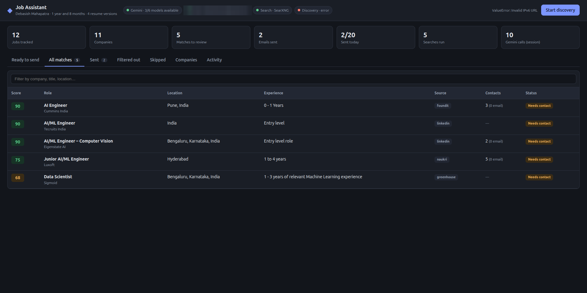
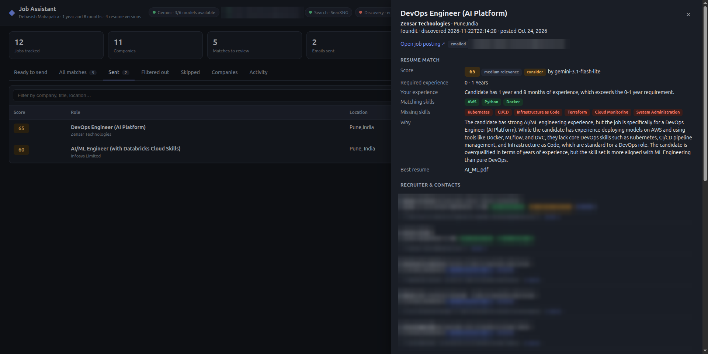

# AI Job Search & Application Assistant

A manually started, human-in-the-loop assistant with a **web dashboard**. It searches job sites through a
self-hosted **SearXNG** instance, ranks postings against your resume with **Gemini**, looks for published
recruiter / HR contacts (with evidence), drafts personalised emails, and sends **only** what you approve.



*Matches ranked by resume fit, with experience requirement, source site, contacts found and status.*



*Job panel: Gemini match analysis (matching / missing skills, experience comparison, reasoning) and
recruiter contacts with verification badges and sources (personal data blurred in this screenshot).*

## Setup

```bash
python3 -m venv .venv && .venv/bin/pip install -r requirements.txt
cp .env.example .env          # put your GEMINI_API_KEY in .env
mkdir -p resumes              # put your resume PDF(s) here (git-ignored)
docker compose up -d          # local SearXNG on 127.0.0.1:8888 (the app also starts it on demand)
```

Gmail (one time): see *Gmail setup* below, then `.venv/bin/python run.py --gmail-auth`.

## Run

```bash
.venv/bin/python run.py                 # startup checks, then opens http://127.0.0.1:8765
.venv/bin/python run.py --check-search  # verify SearXNG
.venv/bin/python run.py --stats         # tracking DB summary
```

Startup: Gemini connectivity test (stops with the exact error if no Gemini model works — never switches
provider) → resume analysis (cached) → Gmail status → SearXNG status → dashboard.

### Dashboard
* **Start discovery / Stop** — runs search passes in the background while the app is open; Stop halts it.
* **Ready to send** — matches with a drafted email. **All matches** — includes jobs still needing a contact.
* Job panel: posting link, match score, matching/missing skills, experience comparison, contacts with
  **verification badge, source link and evidence quote**, editable email (recipient, subject, body, resume).
* **Review & send…** opens a confirmation showing recipient, recruiter, role, subject, full body and the
  attachment. Nothing is sent until you press **Approve & send** there. Duplicate sends and the daily limit
  (`DAILY_EMAIL_LIMIT`, default 20) are blocked server-side.
* **Activity** — live log, plus Gemini model availability / quota.

## How discovery works
1. Rotating search queries (target roles × experience × Indian cities × job sites: Naukri, LinkedIn, Foundit,
   Hirist, Indeed, Cutshort, Wellfound, Instahyre, iimjobs, company ATS pages) via SearXNG, ~1 query per 20 s
   (search engines block fast automated querying). Each query is not repeated within 24 h.
2. Only individual posting URLs are kept. Pages are fetched only where robots.txt allows (LinkedIn is never
   fetched — snippet only). Structured `JobPosting` data is used when present; otherwise Gemini extracts details.
3. Filters (reason recorded): India, AI/ML title, not senior, minimum experience ≤ 2 years, not stale/closed.
4. Gemini match → contact search → email draft (when a contact email exists).

### Experience rules (enforced in code)
| Job asks for | Result |
|---|---|
| 1+ yrs, 1–3, 1–4, 1–any · 0–2 or more · 2+ yrs | kept (2+ yrs: email addresses the gap honestly) |
| 0–1 yr, fresher, entry level, graduate | skipped, unless a strong employer — then kept with score capped at 60 |
| 3+ yrs, internships, trainee roles | skipped |

### Emails
* Written by Gemini from recruiter-style instructions (120–180 words: role + experience, 3–5 matching skills,
  1–2 projects with outcomes, closing). Gemini returns the parts; the app assembles them, so greeting,
  paragraphs and signature are always on separate lines.
* Resume attached with a professional name, e.g. `Firstname_Lastname_AI_ML_Engineer_Resume.pdf`.
* Achievements are only described as the resume states them (no tools/causes added).

### Contacts you add yourself
* Jobs with no email found show **+ Add email**: enter a recruiter address you found, and Gemini drafts the email.
* For jobs where search found an email, the recipient is locked (server-enforced) — pick another found contact
  with **Write email** to change it.
* **Find emails for matches without one** runs a deeper email-focused search (hiring posts, "send your CV to…",
  company careers/contact pages) for every match lacking an email. Recruiters shown hiring for an unrelated
  function (e.g. finance) are flagged and never auto-selected.

### Contact policy
Emails are kept only if they appear **verbatim** in the cited source (checked in code). Data-broker sites
are excluded, masked/pattern addresses rejected, nothing is guessed. Labels: *Verified on page*, *Seen in
search result*, *LinkedIn search result* (name/profile, no email), *Added by you*.

### Gemini free-tier quotas
Each Gemini model has its own small daily free quota. Work is spread over a pool of Gemini models
(heavy: matching/emails, light: extraction); exhausted or overloaded models are skipped until they reset and
every switch is shown in the Activity tab. When all are exhausted, discovery pauses.

## Gmail setup (one time)
1. Google Cloud Console → enable **Gmail API**; OAuth consent screen → add your address as a **Test user**.
2. Credentials → OAuth client ID → **Desktop app** → save JSON as `credentials/credentials.json`.
3. `.venv/bin/python run.py --gmail-auth` and tick **Send email on your behalf**.

## Tests
```bash
.venv/bin/python -m pytest
```
